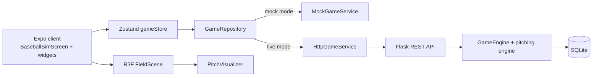

# 3D Field, Pitch Visualization & HUD

**Status:** implemented

**Last updated:** 2026-10-22

**Scope:** the procedural React Three Fiber (R3F) field, camera calibration, projected strike-zone HUD, mock-pitch preview, and IVB-aware pitch kinematics.

This document is the reference for anyone changing the field, camera, strike-zone overlay, or pitch rendering. The calculations here are load-bearing: small sign, unit, or projection mistakes visibly break the alignment between the 3D ball, the glove marker, and the strike zone.

---

## 1. System context

The client is an Expo React Native app that runs on web and native. The simulation authority is a Flask backend; a separate in-client mock engine supports offline/development work.



Key runtime facts:

| Concern | Current implementation |
| --- | --- |
| Backend | Flask on port `5000` (`main.py`) |
| Client | Expo web on `8081`; iOS/Android via Expo |
| Start both | `./scripts/dev.sh` |
| Tests | `./scripts/run_tests.sh` |
| Mock/live switch | `isMockMode` in the Zustand store; `GameRepository` selects the service |
| Backend data | SQLite `backend/database/mlb.db`, seeded from mock JSON |
| 3D renderer | `three` + `@react-three/fiber` + `@react-three/drei`; native uses `expo-gl` |

The client never computes authoritative game outcomes. It renders the state and pitch packets returned by the selected service. The mock pitch preview described in §6 is a visualization aid and is intentionally independent of the real `throwPitch` result.

---

## 2. Coordinate systems and units

This is the highest-risk part of the system. Always document and test conversions here before changing a camera, shape, pitch target, or HUD scale.

### 2.1 World space (Three.js)

| Property | Value |
| --- | --- |
| Unit | **1 world unit = 1 foot** |
| Origin | Rear tip (apex) of home plate at `(0, 0, 0)` |
| `+X` | 1st-base line / right field |
| `-X` | 3rd-base line / left field |
| `+Y` | elevation above ground |
| `-Z` | center field / pitcher |
| Plate plane | `z = 0` |
| Release point (mock) | `[-1.5, 6.0, -59.5]` |

### 2.2 `ShapeGeometry` mapping

A `THREE.Shape` is authored in local XY and rendered with:

```tsx
rotation={[-Math.PI / 2, 0, 0]}
```

That maps local `(x, y)` to world `(x, 0, -y)`. Therefore field-space `z` must be converted with:

```ts
const shapeY = (z: number) => -z;
```

Do not build shapes with negative Y for center field and then apply `-π/2`; that puts the field behind the camera. Do not switch to `+π/2` as a “fix” unless the normals/material side handling is also redesigned.

### 2.3 Statcast / UI target space

The game uses Statcast-style horizontal/vertical coordinates:

| Coordinate | Meaning |
| --- | --- |
| `x` | horizontal location in feet; negative = 3rd-base side, positive = 1st-base side |
| `z` | vertical location in feet |
| plate target | `[x, z, 0]` in world space |
| strike-zone width | `x ∈ [-0.7083, 0.7083]` ft (17 in) |
| strike-zone height | `z ∈ [1.5, 3.5]` ft in the HUD projection |

Pitch arsenal data stores movement in **inches**:

- `horizontal_break_in`: positive = glove side for an RHP
- `induced_vertical_break_in` (IVB): positive = upward break relative to a spinless ball

Convert both to feet before rendering:

```ts
const pfxX = horizontal_break_in / 12;
const pfxY = induced_vertical_break_in / 12;
```

### 2.4 Screen space

| Space | Meaning |
| --- | --- |
| Canvas pixels | R3F `size.width` / `size.height`; CSS pixels on web, layout points on native |
| NDC | `x/y ∈ [-1, 1]` after `Vector3.project(camera)` |
| Screen ratio | `(ndc + 1) / 2` for X; `(1 - ndc) / 2` for Y |
| HUD content | 186 CSS px square (inner 3×3 content, excluding 2 px padding) |

The HUD overlay and the Canvas are separate layers. Aligning them requires projecting the strike-zone bounds, not guessing a fixed `top`.

---

## 3. 3D field

### 3.1 Camera

Both platform shells use:

```tsx
<PerspectiveCamera
  makeDefault
  position={[0, 4.0, 5.5]}
  fov={72}
  onUpdate={(camera) => camera.lookAt(0, 1.5, -60.5)}
/>
```

Why these values:

- The camera sits slightly above/behind the plate and looks toward the pitcher.
- The plate projects into the bottom of the frame, while high pitches still descend or only subtly rise on screen.
- The camera was calibrated iteratively against the projected strike-zone bounds and glove alignment. Changing it requires rechecking:
  - plate screen position,
  - high/low pitch screen direction,
  - projected zone top/bottom,
  - HUD scale/top,
  - marker compensation.

The camera lives in the platform shells (`GameField.tsx`, `GameField.native.tsx`), not in the shared scene.

### 3.2 Lighting and materials

- Ambient light: `0.7`
- Directional light: `[30, 60, 20]`, intensity `1.2`, `castShadow={false}`
- Scene background: `#0A0F15`
- Green: `#2d6a3f`; dirt: `#8e5836`; white: `#f8f9fa`
- No external textures are used for the field.

### 3.3 Geometry

| Element | Geometry / placement |
| --- | --- |
| Outfield turf | Plane `500 × 500`, rotation `[-π/2, 0, 0]`, position `[0, 0, -150]` |
| Dirt skirt | `dirtSkirtShape`, y=`0.005` |
| Infield grass | `infieldGrassShape` with 9-ft mound hole, y=`0.010` |
| Mound | Cylinder `[8.5, 9.0, 0.83, 32]` at `[0, 0.415, -59]` |
| Pitching rubber | Box `[2.0, 0.1, 0.5]` at `[0, 0.84, -60.5]` |
| Bases | Boxes `[1.25, 0.2, 1.25]` at 1B `[63.64, .1, -63.64]`, 2B `[0, .1, -127.28]`, 3B `[-63.64, .1, -63.64]` |
| Home plate | 17 in × 17 in pentagon shape at `[0, 0.015, 0]` |
| Batter’s boxes | 4 × 6 ft outlines at `[±3.21, 0.012, -0.71]` |
| Foul lines | Boxes `[0.35, 0.01, 319.611]` at `[±113, .012, -113]`, yaw `±π/4` |

The 2nd-base/base-corner variance (`-127.28` vs grass corner `-125.0`) is intentional per the field spec; do not “fix” one without updating the other and the associated alignment checks.

### 3.4 Scrims and platform shells

`FieldScrims.tsx` renders the top 14% and bottom 74–100% dark gradient scrims with `react-native-svg` **outside** the Canvas. The HUD and modals remain above them.

Platform split:

- `GameField.tsx` — web shell; `Canvas` from `@react-three/fiber`; `PerspectiveCamera` from `@react-three/drei`.
- `GameField.native.tsx` — native shell; `@react-three/fiber/native` and `@react-three/drei/native`; rendered through `expo-gl`.
- `FieldScene.tsx` — shared scene graph and projection logic.

Metro resolves `.native.tsx` for iOS/Android and the generic web file for web.

---

## 4. Projected strike-zone HUD

### 4.1 Projection source

`PlateProjector` (inside `FieldScene.tsx`) runs after camera/layout changes and reports `ProjectedPlatePosition`:

```ts
interface ProjectedPlatePosition {
  xRatio: number;
  yRatio: number;
  frontRatio: number;
  widthRatio: number;
  zoneTopRatio: number;     // world (0, 3.5, 0)
  zoneBottomRatio: number;  // world (0, 1.5, 0)
  zoneWidthRatio: number;   // world x ±0.7083 at z=0
}
```

The strike-zone HUD uses the `zone*` values. The plate metrics remain available for diagnostics/other overlays.

### 4.2 HUD scaling and placement

The widget’s inner 3×3 content is 186 px (190 minus 2 px padding on each side). Its content top offset inside the widget is 52 px.

```ts
zoneTopPx    = zoneTopRatio * screenHeight;
zoneBottomPx = zoneBottomRatio * screenHeight;
zoneWidthPx  = zoneWidthRatio * screenWidth;

scaleX = zoneWidthPx / 186;
scaleY = (zoneBottomPx - zoneTopPx) / 186;
top    = zoneTopPx - 52 * scaleY;
```

The screen then:

- reserves a wrapper of `WIDGET_WIDTH * scaleX` × `WIDGET_HEIGHT * scaleY`;
- applies `transform: [{ scaleX }, { scaleY }]` with `transformOrigin: 'top center'`;
- passes the same scales to the widget for web responder correction and marker compensation.

At 390 × 844 with the current camera, approximate values are:

| Value | Result |
| --- | --- |
| Zone top / bottom | `452.7 / 659.9 px` |
| Zone width | `148.2 px` |
| `scaleX` / `scaleY` | `0.797 / 1.114` |
| HUD content | `148 × 207 px` |
| HUD top | `394.8 px` |

This projection aligns the 3D target with the 2D glove marker. Measured errors are <1 px for heart/upper/lower/chase-high and in/away targets.

### 4.3 Circular markers under non-uniform scaling

The parent scale is non-uniform, so a circle authored as 18 × 18 becomes an oval and its flex spacing compresses. `ZonePitchMarkers` compensates:

- Each marker gets a layout slot of `18 / scaleX` × `18 / scaleY`.
- The 18 × 18 marker receives `scaleX: 1/scaleX`, `scaleY: 1/scaleY`.
- Net screen size is 18 × 18 with positive gaps.

The glove image is counter-scaled with `width = gloveSize / scaleX`, `height = gloveSize / scaleY`, and `preserveAspectRatio="none"`. Cloud dots use `Ellipse` with `rx = 1.5 / scaleX`, `ry = 1.5 / scaleY`.

Do not inverse-scale the entire widget: cells, heat colors, borders, and projected positions must remain in the projected space.

### 4.4 Background opacity

The HUD panel and inner grid are intentionally translucent:

- `gridBox`: `rgba(13, 19, 26, 0.45)`
- `innerGrid`: `rgba(27, 36, 48, 0.3)`

The heatmap cells retain their own alpha. This lets the 3D field show through without washing out the zone colors.

---

## 5. Mock pitch preview data flow

```text
isMockMode
  → pitch selector tap
  → handleSelectPitchIntent(name)
  → find the selected PitchArsenalItem
  → fireMockPitch(item, name)
  → activePitch state
  → GameField → platform shell → FieldScene
  → keyed PitchVisualizer
  → onComplete
  → setActivePitch(null)
```

### 5.1 `ActivePitchData`

```ts
interface ActivePitchData {
  id: string;
  release: [number, number, number];
  plate: [number, number, number];
  pfx: [number, number];
  flightTime: number;
}
```

### 5.2 Target and arc data

- Release: `[-1.5, 6.0, -59.5]`.
- Plate target: the currently selected glove/zone target, mapped as `[target.x, target.z, 0]`.
- `pfx`: `[horizontal_break_in / 12, induced_vertical_break_in / 12]`.
- Flight time: `59.5 / (velocity_mph * 1.4667)` seconds.
- The mock preview intentionally targets the selected glove/zone; it no longer randomizes the plate location.
- Tapping a pitch in mock mode starts a preview. The existing hold-to-throw path can also start one because it invokes selection before throwing.

Per-pitch values from the current mock arsenal:

| Pitch | HB (in) | IVB (in) | pfx (ft) | Flight (s) |
| --- | --- | --- | --- | --- |
| Spin Monster Sweeper | +18.2 | +4.5 | `[+1.517, +0.375]` | ~0.480 |
| Four-Seam Fastball | -7.5 | +16.0 | `[-0.625, +1.333]` | ~0.414 |
| Power Sinker | -14.0 | +6.0 | `[-1.167, +0.500]` | ~0.419 |
| Spike Curveball | -8.0 | -12.0 | `[-0.667, -1.000]` | ~0.500 |

The hardcoded category profiles are fallbacks only when an arsenal item lacks movement data.

---

## 6. Pitch kinematics

`PitchVisualizer.tsx` is a one-shot render, not a loop. At each frame:

```ts
t = elapsed / flightTime;          // 0..1
timeSeconds = elapsed;
```

### 6.1 Horizontal

Aim at the pre-break target, then add a quadratic break:

```ts
targetX = plate.x - pfx.x;
x = lerp(release.x, targetX, t) + pfx.x * t²;
```

### 6.2 Vertical: gravity baseline + IVB

IVB is the deviation from a gravity-only/spinless ball. The spinless ball would finish at `plate.y - IVB`; the IVB lift closes that gap.

```ts
baselineY = plate.y - pfx.y;
g = 32.174; // ft/s²
v0 = (baselineY - release.y + 0.5 * g * flightTime²) / flightTime;
gravityY = release.y + v0 * timeSeconds - 0.5 * g * timeSeconds²;
y = gravityY + pfx.y * t²;
```

### 6.3 Depth

```ts
z = lerp(release.z, plate.z, t);
```

### 6.4 Guarantees

- `t=0` → release point.
- `t=1` → exactly `plate` target (for both horizontal and vertical).
- `pfx=[0,0]` → straight release-to-plate line.
- Positive IVB lifts the ball relative to the gravity baseline; negative IVB drops it.
- The ball’s endpoint is the same Statcast target used by the glove marker; with the projected HUD, the two align on screen.

`onComplete()` fires once at the end of `flightTime`; the parent clears `activePitch`, unmounting the visualizer. The keyed render resets the trail for every pitch.

---

## 7. Live vs mock data flow

### Live

```text
BaseballSimScreen
  → useGameStore.throwPitch()
  → GameRepository
  → HttpGameService
  → Flask route
  → GameEngine/pitching engine
  → SQLite + response packet
  → Zustand state
  → widgets + 3D scene
```

### Mock

`GameRepository` selects `MockGameService` when `isMockMode` is enabled. Mock and live services implement the same `IGameService` contract:

```ts
getState()
startGame()
pitch()
simAtBat()
reset()
swapLineup()
swapRotation()
```

Frontend contracts live in `src/types/api.ts`; backend server contracts are returned by `backend/api/routes.py`. These are currently maintained in parallel and need parity tests to prevent drift.

Key backend routes:

- `GET /api/health`
- `GET /api/state`
- `POST /api/start_game`
- `POST /api/pitch`
- `POST /api/sim_at_bat`
- `POST /api/reset`
- `POST /api/swap_lineup`
- `POST /api/swap_rotation`
- `GET /api/rosters`

---

## 8. Component/file map

```text
frontend/app/src/
├── components/
│   ├── GameField.tsx              # web R3F shell + camera
│   ├── GameField.native.tsx       # native R3F shell + camera
│   ├── StrikeZoneGridWidget.tsx   # HUD, glove/cloud, markers, chase zones
│   └── gamefield/
│       ├── types.ts               # ProjectedPlatePosition, ActivePitchData, GameFieldProps
│       ├── fieldGeometry.ts       # pure shapes/constants
│       ├── FieldScene.tsx         # lights, field meshes, PlateProjector, conditional visualizer
│       ├── FieldScrims.tsx        # top/bottom scrims
│       ├── PitchVisualizer.tsx    # release ghost, ball, trail, IVB kinematics
│       ├── useThree.ts            # web shim
│       └── useThree.native.ts     # native shim
├── screens/
│   └── BaseballSimScreen.tsx      # store, mock preview state, projected HUD, modals
├── services/
│   ├── IGameService.ts
│   ├── GameRepository.ts
│   ├── HttpGameService.ts
│   ├── MockGameService.ts
│   └── gamedayMath.ts
└── store/
    └── gameStore.ts
```

---

## 9. Verification

Checks used during this work:

```bash
export PATH="$HOME/.nvm/versions/node/v24.11.0/bin:$PATH"
cd frontend/app
npx tsc --noEmit
npx expo export --platform web
npx expo export --platform ios

cd ../..
./scripts/run_tests.sh
```

Numeric/geometry checks performed:

- ShapeGeometry triangulation and mound-hole cut.
- Plate/dirt/infield shape bounding boxes and orientation.
- Pitch endpoints at `t=0` and `t=1`.
- Per-pitch IVB values and flight times.
- Projected glove vs 3D target alignment (heart, upper, lower, chase-high, in/away) within <1 px.
- Marker size/spacing under the current HUD scales.
- `tsc` and web/iOS exports after the final changes.
- Backend suite: 31 tests passed during this work; backend code was not modified by this feature.

No browser was available in the development environment, so final visual checks (HUD/footer overlap, native GL behavior, trail appearance) remain manual.

---

## 10. Known limitations and risks

- **HUD/footer proximity:** the projected HUD is taller and lower than the previous fixed overlay; its bottom chase band may sit near the pitch footer and could overlap pointer targets on some screens.
- **Marker wrapping:** compensated marker slots are larger than the old layout; zones with many pitches may wrap or slightly overflow narrow cells/chase strips.
- **Native GL:** `Trail`/`meshline` shader behavior should be smoke-tested on a physical iOS/Android device.
- **Mock preview vs actual pitch:** the preview is a rendering harness; it is not the outcome of the real `throwPitch` simulation and does not simulate command error.
- **Hold-to-throw:** a hold can start a preview because the selector invokes selection before throwing; this is known behavior, not a bug.
- **Physics approximation:** the kinematics use a gravity baseline plus IVB and a quadratic horizontal break; this is a visual model, not a full aerodynamic solver.
- **Camera trade-offs:** the final camera keeps high pitches from visually rising too strongly but pushes the plate/zone lower; camera changes require recalibrating the HUD and marker compensation.
- **Documentation debt:** most backend/API/state-machine docs are still planned; this document covers the 3D/HUD/pitch subsystem.
- **Git history:** the pre-R3F `GameField.tsx` was untracked. Unless a baseline commit is created, git history will not show the removed SVG implementation.

---

## 11. Design decisions (ADR summary)

| Decision | Rationale |
| --- | --- |
| Replace SVG with procedural R3F field | Data-driven, no textures, consistent 3D scale, camera-driven projection. |
| Web/native shell split | Web uses `@react-three/fiber`; native uses `expo-gl` and the native entries. |
| Keep scrims as RN SVG overlay | Preserves HUD legibility without putting 2D gradients in the 3D scene. |
| Project the HUD onto the 3D strike zone | Makes the glove marker and pitch endpoint align on screen. |
| Independent X/Y HUD scales | The projected 3D zone is not square; uniform scaling broke glove alignment. |
| Compensate markers/icons | Non-uniform HUD scaling would otherwise squash circles and spacing. |
| Target the selected glove/zone | Makes repeated mock pitches repeatable and testable. |
| Gravity baseline + IVB | Matches the definition of IVB as lift relative to a spinless ball. |
| One-shot visualizer + `onComplete` | Clears the preview and avoids the earlier looping-trail artifact. |
| Consolidate scripts in `scripts/` | Single startup contract for backend + Expo, path-independent. |
