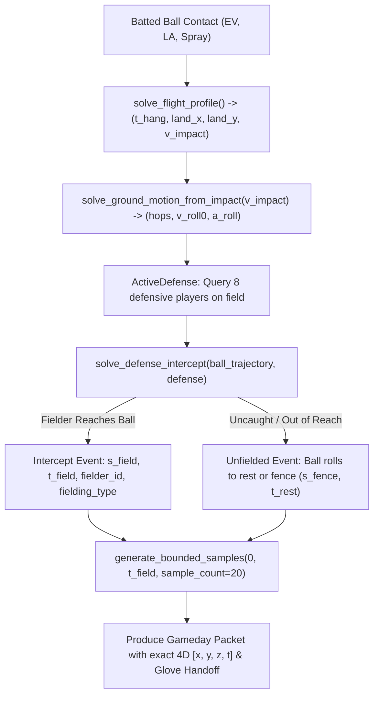

# System Design: Dynamic Defensive Fielders & Continuous Ball Flight Kinematics

**Date:** 2026-11-20  
**Status:** Phases 1–4 Complete (Dynamic Intercept, Frontend Pursuit, and Throw Kinematics Implemented)  
**Target Modules:**  
- `backend/engine/models/player.py`
- `backend/database/roster_store.py`
- `backend/engine/game_engine/physics/ball_flight.py`
- `backend/engine/game_engine/physics/fielder_intercept.py`
- `backend/engine/game_engine/physics/fielder_throw.py`
- `backend/engine/game_engine/physics/runner_timing.py`
- `backend/engine/batting_engine/contact/contact_outcome.py`
- `backend/engine/game_engine/orchestration/packet_builder.py`
- `backend/engine/game_engine/main.py`

---

## 1. Intent & The Why

### Problem Statement
Currently, batted ball physics in `ball_flight.py` has a hard 10-degree split:
- Ground balls ($< 10^\circ$) simulate multi-hop bounces and Coulomb friction rolling to a stop.
- Line drives and fly balls ($\ge 10^\circ$) terminate physics the exact moment they touch the grass ($z = 0$), freezing uncaught hits dead on the field.

Furthermore, fielders on defense are represented solely as static coordinates with hardcoded circular reach radii (`FIELDERS` tuple). Fielders do not possess individual defensive ratings, do not react or sprint, and cannot dynamically intercept balls rolling through gaps or sinking in front of them.

### Goal
1. **Continuous Flight-to-Rollout Kinematics:** When a line drive or fly ball lands uncaught, its impact velocity vector is passed into ground kinematics (Dr. Alan Nathan rebound equations + turf friction), allowing balls to realistically skip and roll towards the wall.
2. **Granular Fielder Attribute System (0–99):** Introduce a comprehensive, Statcast-grade defensive ratings framework on `Player` across Tracking, Glove, Throwing, and Mental categories with positional weight matrices and minimum gates.
3. **Kinematic Fielder Intercept Solver:** Dynamically calculate the pursuit path of defenders (reaction delay, route efficiency, sprint speed, glove reach) to determine the exact intercept coordinate $(x, y, z)$ and timestamp $t_{\text{field}}$.
4. **Clean Animation Handoff Contract:** Sample the trajectory directly to the intercept boundary with 4D coordinates `[x, y, z, t]` and metadata (`fielder_id`, `fielding_type`, `fielder_start`, `intercept_point`), guaranteeing zero visual pops when transitioning the ball into the glove.

### Non-Goals
- Real-time 60 FPS multi-agent avoidance pathfinding (fielders run direct route-efficiency adjusted paths).
- Throwing flight trajectories and base runner tag animations (this design handles bat-contact through glove capture; throwing mechanics form the subsequent phase).
- Dynamic wind or atmospheric weather modeling on the roll.

### Anti-Goals
- Naive post-sampling array truncation (which destroys sample resolution and drops 4D timestamps, reverting frontend animation to uniform speed).
- Hardcoding defensive attributes in configuration files rather than hydrating from `Player` instances.

---

## 2. Granular Defensive Ratings & Positional Matrix

### 2.1 Granular Ratings Architecture (0–99 Scale)

Every position player in the domain model (`Player`) supports the following defensive ratings via `player.get_rating(key, default)`:

#### A. Tracking
- **`reaction`**: Start delay before sprint break ($t_{\text{react}} \in [0.15\text{s}, 0.45\text{s}]$).
- **`route_efficiency`**: Path linearity and angle selection ($\eta \in [0.85, 1.00]$, where 1.0 is a direct line).
- **`range`**: Lateral agility and peak sprint velocity ($v_{\text{sprint}} \in [23.0, 30.5\text{ ft/s}]$).

#### B. Glove
- **`fielding`**: Catch window radius, glove reach, and error minimization ($r_{\text{glove}} \in [3.2, 5.5\text{ ft}]$).
- **`transfer_speed`**: Glove-to-hand transition time ($t_{\text{transfer}} \in [0.45\text{s}, 0.85\text{s}]$).

#### C. Throwing (Prepared for Throw Phase)
- **`arm_strength`**: Max throwing velocity ($v_{\text{throw}} \in [70, 102\text{ mph}]$).
- **`arm_accuracy`**: Angular dispersion cone ($\pm \text{degrees}$).
- **`body_control`**: Retention of slot and balance when fielding on the run or off-balance.

#### D. Mental
- **`positioning`**: Pre-pitch spatial shading offset from standard depth.
- **`baseball_iq`**: Internal clock, cutoff decision-making, and runner advance anticipation.

### 2.2 Position Weight Matrix & Minimum Gates

$$\text{CompositeRating} = \sum_{i} w_i R_i - \text{GatePenalty}$$

| Rating Component | SS | 2B | 3B | 1B | CF | RF | LF |
| :--- | :---: | :---: | :---: | :---: | :---: | :---: | :---: |
| **Range** | 0.35 | 0.35 | 0.15 | 0.10 | 0.40 | 0.25 | 0.30 |
| **Reaction** | 0.20 | 0.20 | 0.25 | 0.20 | 0.25 | 0.20 | 0.25 |
| **Route Efficiency** | — | — | — | — | 0.20 | 0.15 | 0.20 |
| **Arm Strength** | 0.20 | 0.05 | 0.30 | 0.05 | 0.10 | 0.30 | 0.10 |
| **Transfer Speed** | 0.10 | 0.25 | 0.05 | 0.05 | — | — | — |
| **Fielding** | 0.10 | 0.10 | 0.20 | 0.50 | 0.02 | 0.03 | 0.10 |
| **Accuracy / Control**| 0.05 | 0.05 | 0.05 | 0.10 | 0.03 | 0.07 | 0.05 |

#### Minimum Positional Gates:
- **SS**: $\text{Range} \ge 60$, $\text{Arm Strength} \ge 55$ (Penalty: $-15$ pts if unfulfilled).
- **2B**: $\text{Range} \ge 50$ (Penalty: $-10$ pts if unfulfilled).
- **3B**: $\text{Arm Strength} \ge 60$ (Penalty: $-15$ pts if unfulfilled).
- **1B**: $\text{Height} \ge 6'2''$ or $\text{Fielding} \ge 65$ (Penalty: $-10$ pts if unfulfilled).
- **CF**: $\text{Range} \ge 65$ (Penalty: $-20$ pts if unfulfilled).
- **RF**: $\text{Arm Strength} \ge 55$ (Penalty: $-10$ pts if unfulfilled).
- **LF**: None.

#### Experience Multiplier:
$$\text{Rating}_{\text{curr}} = \text{CompositeRating} \times \left(0.65 + 0.35 \cdot \min\left(1.0, \frac{\text{GamesAtPosition}}{200}\right)\right)$$

---

## 3. Kinematic Architecture: From Flight to Glove



### 3.1 Seamless Aerial $\to$ Ground Handoff & Fence Boundaries
In `ball_flight.py` and `contact_outcome.py`:
1. **Home Run Pre-Screening:**
   - If a fair ball carries beyond the outfield fence distance on the fly ($d \ge \text{fence}$) and clears fence height ($z \ge \text{fence\_height}$, default 8.0 ft):
     - The play is immediately classified as a `HOME_RUN`.
     - It bypasses ground motion and fielder pursuit entirely.
2. **Fence Collisions for Ground Rollout:**
   - An uncaught ball rolling across the outfield turf stops when reaching the fence boundary ($s \ge s_{\text{fence}}(\text{spray})$). Complex wall caroms are out of scope; the ball clamps to rest at the wall.
3. **Flight-to-Rollout Connection:**
   - If a ball lands cleanly in the field of play ($z=0$ reached inside fence):
     - Terminal horizontal velocity: $v_{xy,\text{impact}} = v_{0xy} e^{-k \cdot t_{\text{hang}}}$.
     - Terminal vertical velocity: $v_{z,\text{impact}} = -(v_{0z} - g_{\text{eff}} \cdot t_{\text{hang}})$.
     - Feed $(v_{xy,\text{impact}}, v_{z,\text{impact}})$ into `solve_ground_motion()` with grass coefficients ($\text{COR}_v = 0.42, \text{COR}_h = 0.70$) to model skips and roll.

### 3.2 Fielder Pursuit & 3D Intercept Algorithm
1. **Defensive Alignment & Fallbacks:**
   - `ActiveDefense` resolves the 8 defensive players on the field from the defending team lineup and active pitcher (`P`, `1B`, `2B`, `3B`, `SS`, `LF`, `CF`, `RF`).
   - If called without active defense (e.g., standalone unit tests or practice mode), it auto-populates default standard players for all 8 positions.
2. **Vertical Catch Window ($z_{\text{max}}$):**
   - A fielder cannot intercept a ball above their physical reach ceiling: $z \le z_{\text{max}} = 8.5\text{ ft}$ (extended to $9.5\text{ ft}$ for `WALL_LEAP`). Balls flying overhead at $z > 8.5\text{ ft}$ cannot be intercepted in mid-air.
3. **Pursuit Kinematics:**
   - Each fielder $i$ has start position $(x_i, y_i)$.
   - Reaction start delay: $t_{\text{react}} = 0.45 - (\text{reaction}_i / 100) \times 0.25\text{s}$.
   - Route efficiency distance: $d_{\text{eff}} = d_{\text{euclidean}} / \eta_{\text{route}, i}$.
   - Sprint speed: $v_{\text{sprint}} = 22.0 + (\text{range}_i / 100) \times 8.5\text{ ft/s}$.
   - At time $t > t_{\text{react}}$, reachable radius is:
     $$R_i(t) = v_{\text{sprint}} \cdot (t - t_{\text{react}}) + r_{\text{glove}}(\text{fielding}_i)$$
4. **Earliest Arrival Selection:**
   - Step along the ball trajectory $\vec{r}(t) = [x(t), y(t), z(t)]$.
   - An intercept occurs when $z(t) \le z_{\text{max}}$ AND distance from fielder start to $(x(t), y(t)) \le R_i(t)$.
   - If multiple fielders can reach, the ball is awarded to the fielder with the earliest arrival time $t$.

### 3.3 Catch Classification (`fielding_type`) & Play Outcome Resolution
1. **Catch Classification:**
   - **`ROUTINE_FLY_CATCH`**: Caught airborne ($z \ge 2.5\text{ ft}$), arrival margin $\Delta t \ge 0.35\text{s}$.
   - **`RUNNING_CATCH`**: Caught airborne ($z \ge 2.5\text{ ft}$), arrival margin $\Delta t < 0.35\text{s}$.
   - **`SLIDING_CATCH`**: Caught airborne right before ground ($0.3\text{ ft} \le z < 2.5\text{ ft}$), tight margin.
   - **`DIVING_CATCH`**: Intercepted at $R_i(t)$ maximum extension ($z < 2.5\text{ ft}$).
   - **`GROUND_SCOOP`**: Intercepted while rolling on turf ($z = 0\text{ ft}$).
   - **`BACKHAND_PICK`**: Ground ball intercepted across the fielder's backhand orientation.
   - **`WALL_LEAP`**: Intercepted within 5 ft of fence at $z \ge 7.0\text{ ft}$.

2. **Play Outcome Resolution (`call` Mapping):**
   - **Airborne Catches:** Any airborne intercept ($z > 0.2\text{ ft}$) is an `IN_PLAY_OUT`.
   - **Infield Ground Intercepts:** An infielder intercepting a rolling ball ($s_{\text{intercept}} \le 165\text{ ft}$) produces an `IN_PLAY_OUT` (routine groundout).
   - **Outfield Ground Intercepts (Clean Base Hits):**
     - If the ball is fielded deep in the gap or along the warning track ($s_{\text{intercept}} \ge 310\text{ ft}$ or $t_{\text{intercept}} \ge 4.4\text{s}$ with speed): `TRIPLE`.
     - If fielded in the intermediate outfield ($s_{\text{intercept}} \ge 260\text{ ft}$ or $t_{\text{intercept}} \ge 3.4\text{s}$): `DOUBLE`.
     - Otherwise (prompt cut-off or shallow single): `SINGLE`.
   - **Unfielded Ball at Fence:** Automatically scored as `DOUBLE` (or `TRIPLE` down the corner line).

### 3.4 Bounded Trajectory Sampling
To guarantee zero loss of fidelity:
- Trajectory is **never truncated after sampling**.
- Once $t_{\text{intercept}}$ and $s_{\text{intercept}}$ are determined, `_generate_bounded_samples(motion, t_start=0, t_end=t_intercept, sample_count=20)` generates exactly 20 monotonically increasing samples with physical timestamps:
  ```json
  samples[0] = [0.0, 0.0, 3.0, 0.0]
  ...
  samples[19] = [x_glove, y_glove, z_glove, t_intercept]
  ```

---

## 4. Telemetry Contract (Gameday Packet)

The `batted_ball` dictionary in the packet payload is extended:

```json
{
  "exit_velocity_mph": 98.4,
  "launch_angle_deg": 16.5,
  "spray_angle_deg": -18.2,
  "hang_time_s": 3.42,
  "distance_ft": 268.4,
  "landing_x_ft": -83.7,
  "landing_y_ft": 255.0,
  "apex_height_ft": 32.1,
  "fielded": true,
  "fielder_id": "LF",
  "fielder_name": "Alex Verdugo",
  "fielding_type": "GROUND_SCOOP",
  "fielder_start": [-115.0, 255.0],
  "intercept_point": [-83.7, 255.0, 0.0],
  "sample_count": 20,
  "samples": [
    [0.0, 0.0, 3.0, 0.0],
    [-21.2, 64.5, 18.2, 0.85],
    [-62.1, 189.4, 1.2, 2.45],
    [-83.7, 255.0, 0.0, 3.42]
  ]
}
```

---

## 5. What is Left to the Builder

- Exact calibrated baseline coordinates $(x_0, y_0)$ for depth variants (standard, in, deep).
- Fallback default values for players loaded from bare database records without granular defensive ratings.
- Unit test coverage validating strictly monotonic 4D sample timestamps and boundary constraints across all archetypes.

---

## 6. Phase 4: Fielder Throw Kinematics & Base Runner Timing

### 6.1 Glove-to-Hand Transfer Kinematics
- Base transfer time scales linearly:
  $$t_{\text{transfer}} = 0.85 - \left(\frac{\text{transfer\_speed}}{100}\right) \times 0.40\text{ s}$$
- Off-balance / ground recovery penalties:
  - `DIVING_CATCH` / `SLIDING_CATCH`: $+0.50 \times \max(0.20, 1.0 - \text{body\_control} / 150.0)\text{ s}$
  - `BACKHAND_PICK`: $+0.20 \times \max(0.20, 1.0 - \text{body\_control} / 150.0)\text{ s}$

### 6.2 Fielder Throw & 1B Unassisted Resolution
- **1B Unassisted Step:** If 1B fields a ground ball within $12\text{ ft}$ of the first base bag $(63.64, 63.64, 3.0)\text{ ft}$, 1B steps on the bag directly (`is_unassisted = True`) without throwing to themselves.
- **Throw Trajectory:**
  $$v_{\text{throw\_mph}} = 70.0 + \left(\frac{\text{arm\_strength}}{100}\right) \times 32.0\text{ mph}$$
  Flight time accounts for air drag ($0.95 \times v_{\text{fps}}$), yielding 10 monotonic 4D parabolic samples $[x, y, z, t]$.

### 6.3 Batter-Runner Sprint & Out/Safe Adjudication
- Home-to-first sprint time:
  $$t_{\text{home\_to\_first}} = 4.85 - \left(\frac{\text{speed}}{100}\right) \times 0.85\text{ s} - (0.08\text{ s if LHB})$$
- Authoritative clock comparison:
  $$\Delta t = t_{\text{ball\_at\_1B}} - t_{\text{runner\_at\_1B}}$$
  - $\Delta t \le 0.0 \implies$ `IN_PLAY_OUT`
  - $\Delta t > 0.0 \implies$ `SINGLE` (Infield Single)
  - Close play badge awarded when $|\Delta t| \le 0.15\text{ s}$.


